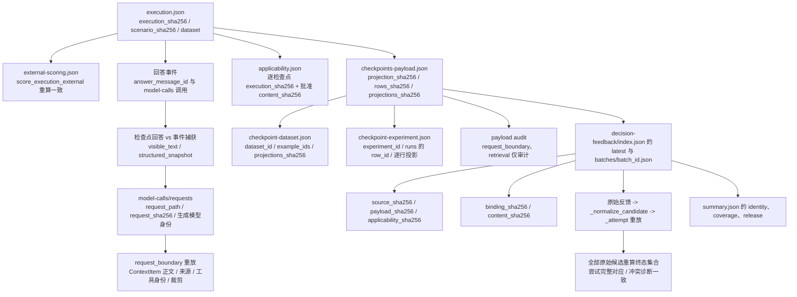

# 外部裁判报告与发布门禁操作手册

## 1. 入口职责

| 入口 | 输入布局 | 用途 |
|---|---|---|
| `evaluation.summary` | `<run>/run.json` + `plan.json` | 本地 Ragas 场景运行的报告与门禁；拒绝 `scoring_mode=external` |
| `evaluation.sdk_summary` | SDK `run.json`（检索）与 `sdk-run.json`（场景） | Ragas 与 external 的协议分发、综合报告、正式门禁与 `write-v3` |
| `evaluation.decision_feedback` | 外部运行目录 | 反馈回收前离线校验（`check`）与云端读取（`collect`） |
| `evaluation.generation_upload` | 外部运行目录 | 适用性审阅、投影、数据集同步与实验提交 |
| `evaluation.langsmith_scenarios` | 场景 SDK 运行目录 | 外部场景执行、finalize 与运行摘要 |

外部运行只支持 SDK 目录 `<run_id>/sdk-run.json`。`evaluation.summary` 不读取该布局。

## 2. 产物布局与选择批次

```text
backend/temp/scenario-langsmith/runs/<run_id>/
  sdk-run.json
  scenarios/<example_id>/<scenario_id>/
    execution.json
    external-scoring.json
    external-evaluation.json
  external-judge/
    applicability.review.json
    applicability.json
    checkpoints-payload.json
    coverage-ledger.json
    checkpoint-dataset.json
    checkpoint-experiment.json
    decision-feedback/
      feedback-binding.json
      index.json
      batches/batch-<content_sha256[:16]>.json
```

汇总只读取 `decision-feedback/index.json` 的 `latest` 与对应批次。`latest` 为 `pending` 或 `blocked` 时报告该状态，不回退旧 `complete`。历史批次只用于身份与内容一致性校验。

批次 `complete` 表示所有适用指标已有合法终态，终态可以是 `failed`。`pending` 表示仍有指标待回收或检查点未上传；`blocked` 表示校验阻断；全 N/A 可以 `complete` 且没有检查点裁判实验。

## 3. 离线报告与门禁命令

在仓库根执行：

```powershell
uv run --locked --directory backend python -m evaluation.sdk_summary check --retrieval <retrieval-run> --scenarios <run_id-dir> --dataset backend/dataset/evaluation/rebuild-v3
uv run --locked --directory backend python -m evaluation.sdk_summary report --retrieval <retrieval-run> --scenarios <run_id-dir> --dataset backend/dataset/evaluation/rebuild-v3 --output <output-dir>
uv run --locked --directory backend python -m evaluation.sdk_summary write-v3 --retrieval <retrieval-run> --scenarios <run_id-dir> --dataset backend/dataset/evaluation/rebuild-v3 --output <output-dir> --v3 quantitive-index/v3.md
```

参数：

- `--retrieval`：检索 SDK `run.json` 或其目录。正式发布要求 `purpose=formal`、三组完整、冻结参数与物理索引身份一致。
- `--scenarios`：外部运行目录或其中的 `sdk-run.json`。
- `--dataset`：批准数据版本目录，默认 `backend/dataset/evaluation/rebuild-v3`；外部运行数据身份必须与它一致。显式指定 `rebuild-v1`/`rebuild-v2` 时按各自 80 条基线校验。
- `--scope`：`auto`、`formal`、`validation`，默认 `auto`。定向来源使用 `formal` 仍会阻断。
- `--output`：`report` 与 `write-v3` 的 `summary.json`、`report.md` 输出目录。
- `--v3`：显式指定被更新的文档；文件必须有唯一 `<!-- sdk-summary:start -->` 与 `<!-- sdk-summary:end -->` 标记。

输出：

- `<output-dir>/summary.json`：外部协议使用 `fit-agent-external-judge-summary-1`；Ragas 继续使用 `fit-agent-evaluation-summary-1`。
- `<output-dir>/report.md`：外部报告标题为“外部裁判汇总”，Ragas 报告保持原模板。

退出码：

| 命令 | 0 | 1 | 非捕获异常 |
|---|---|---|---|
| `check` | `release.effective=true` | 发布阻断 | 协议或数据无法解析时退出并打印原因 |
| `report` | 文件写入完成 | 不返回 1 | 同上 |
| `write-v3` | 文件写入完成 | 不返回 1 | 标记冲突或协议错误时退出 |

`check` 与 `report` 完全离线，不创建 LangSmith Client，不执行 `collect`、上传、重评分或业务重跑。`write-v3` 只在显式调用时更新目标文件。

## 4. 报告 Schema 关键字段

| 字段 | 内容 |
|---|---|
| `schema` | `fit-agent-external-judge-summary-1` |
| `scoring_mode` / `protocol_version` / `feedback_version` | 外部协议身份 |
| `definitions.metrics` | `evidence_supported_v1`、`reference_requirements_met_v1` 与 Noul 概率语义 |
| `definitions.aggregation` | 场景内均值、场景间宏平均、两个完整口径与排除规则 |
| `identity` | dataset/code/generation/index、`source_sha256`、`payload_sha256`、`applicability_sha256`、`binding_sha256`、逐行投影摘要、索引/批次、两个实验身份与来源路径 |
| `judge` | Provider、Evaluator、`evaluator_id`、模型别名、配置摘要、问题/评分标准摘要、reported/unreported 版本 |
| `coverage` | 场景/检查点分母、任务 3 分类计数、每指标计数与维度恒等关系 |
| `generation.metrics` | 每指标预期/适用/N/A/成功/失败/待回收/缺失/阻断/未批准、场景值、两个均值 |
| `execution` / `assertions` | 执行状态、事件/检查点覆盖、上下文缺口、断言统计与缺失检查点 |
| `retrieval` | SDK 检索组别、指标、索引、实验与整体状态 |
| `release` | `effective`、`blocking_issues`、范围/执行/断言/反馈/生成/检索检查项、`quality_reviewed` |

`source_assurance` 固定为 `declared_binding`，并写入限制说明。`unreported` 版本只表示服务未返回具体版本。

## 5. 分母、宏平均与阻断

指标预期键来自已批准适用性：`(scenario_id, event_id, checkpoint_id, metric)`。

- 场景内均值：该指标成功检查点分数算术平均。
- 场景间均值：有数值场景的等权宏平均。
- `mean_including_partial`：至少一项成功的场景进入分母。
- `mean_complete_only`：全部适用检查点成功且至少一项成功数值的场景进入分母。
- 全 N/A 场景 `value=null`；失败、缺失、待回收、阻断、未批准项不填 0；真实 0 分进入均值。

阻断条件包括：非正式范围、执行未完成、断言未完整执行或未全部通过、回答未关联真实模型调用、检查点回答正文或结构化快照与事件捕获不一致、请求文件缺失或摘要不符、生成模型身份不符、请求上下文重放不一致、上下文无法绑定、源/代码/索引/模型身份不一致、任务 3/4 摘要不一致、原始反馈按生产语义重算后与已保存状态/分数/失败依据/模型版本/来源身份不一致、评分尝试未完整对应原始候选终态集合、冲突诊断与原始终态集合不一致、最新批次非 `complete`、适用指标存在 `failed`/`pending`/`missing`/`blocked`/`unapproved`、检索三组不完整或检索身份不一致、缺少正式检索来源。

`batch.status=complete` 内含 `failed` 时发布阻断。全 N/A 不提供数值，也不替代执行、断言与检索条件。外部契约没有分数通过阈值；证据与流程门禁满足不代表模型质量达标，未人工审阅时 `quality_reviewed=false`。

## 6. declared_binding 与版本限制

来源保证为显式软链：

- 需要 `feedback-binding.json` 的显式绑定、feedback key 映射、`feedback_source.type` 为 `model`/`evaluator`、以及 `feedback_source.metadata.typesafe` 对象。
- 不要求 SDK Evaluator 注册表唯一匹配，不宣称服务唯一证明 Evaluator 身份。
- 服务返回的 `typesafe.model` 等于声明别名或以 `-latest`/`-preview` 结尾时记录 `UnreportedModelVersion`；其他非空具体版本记录 `ReportedModelVersion`。
- `declared_binding`、具体版本未返回都不新增发布阻断；任务 4 的来源缺口、身份冲突、内容漂移、历史冲突、非法分数、缺少云端运行与配置漂移阻断保持不变。
- 一个回收索引固定一套 `feedback-binding.json`。汇总校验每条评分尝试的 Provider、Evaluator、模型别名、配置摘要、问题与评分标准摘要与绑定一致；不同配置的分数不合并。服务返回的具体版本差异按 reported 列出，不视为可合并的配置差异。

局部均值、定向场景均值与全 N/A 结果只用于诊断，不能作为正式发布成绩。

## 7. 从执行到报告的身份追溯



每个环节的摘要不一致会在 `check` 或汇总加载阶段阻断，命令不自动修复、不重新上传、不重新评分。

## 8. 真实端到端验收清单

以下环节需要用户另行授权真实模型、LangSmith 与费用；本轮全部未执行。

1. 真实执行与确定性断言：
   `uv run --locked --directory backend python -m evaluation.langsmith_scenarios run --purpose formal --scoring-mode external`
   产物：`backend/temp/scenario-langsmith/runs/<run_id>/scenarios/**/execution.json`、`external-scoring.json`。
2. 已批准适用性与脱敏投影：
   `uv run --locked --directory backend python -m evaluation.langsmith_scenarios finalize --run <run_id-dir>`；
   `uv run --locked --directory backend python -m evaluation.generation_upload external-review --source <run_id-dir>`；
   用户填写 `external-judge/applicability.json` 后执行 `external-project`。
   产物：`applicability.json`、`checkpoints-payload.json`、`coverage-ledger.json`。
3. 数据集同步：
   `uv run --locked --directory backend python -m evaluation.generation_upload external-sync --source <run_id-dir>`
   前置条件：可用的 `LANGSMITH_API_KEY`、用户对数据集写入的授权。
4. 绑定 Decision Model Evaluator：
   在 LangSmith 网页为检查点数据集配置两项 Noul Question，State 使用 `inputs.user_request`、`outputs.answer`、`outputs.context.items`、`reference_outputs.reference`；写入 `decision-feedback/feedback-binding.json`。
5. 授权提交评分：
   `uv run --locked --directory backend python -m evaluation.generation_upload external-submit --source <run_id-dir> --confirm-external-judge-cost`
   前置条件：用户对真实 Jev 调用与费用的独立授权。
6. 实际反馈回收：
   `uv run --locked --directory backend python -m evaluation.decision_feedback collect --source <run_id-dir> --wait-seconds 60`
   前置条件：`checkpoint-experiment.json`、匹配的绑定、可用的 LangSmith 凭据。
7. 汇总与检索/重排门禁：
   `uv run --locked --directory backend python -m evaluation.sdk_summary check --retrieval <formal-retrieval-run> --scenarios <run_id-dir> --dataset backend/dataset/evaluation/rebuild-v3 --scope formal`
   前置条件：正式全量 40 场景、正式检索运行与完整身份证据。
8. 人工审阅裁判质量：
   检查两项 Noul 的判定、unreported 版本、冲突与排除记录；`quality_reviewed` 只能由人工审阅确认。

缺少费用授权、凭据、真实全量运行、正式检索来源或人工审阅时，`release.effective` 保持 `false`，不得宣称真实外部验收或正式发布完成。

## 9. 本轮离线验证记录

2026-10-21 由 subagent 实际运行，全部离线。命令退出码均为 0。

| 命令 | 结果 |
| --- | --- |
| `uv run --locked --directory backend python -m pytest test/test_external_summary.py -q -k "conflict_attempt_cannot_be_dropped or checkpoint_answer_must_match" --basetemp=temp/p1b-targeted` | 3 passed，30 deselected |
| `uv run --locked --directory backend python -m pytest test/test_external_summary.py -q --basetemp=temp/p1b-external-summary-full` | 33 passed |
| `uv run --locked --directory backend python -m pytest test/test_external_judge_checkpoints.py -q --basetemp=temp/p1b-checkpoints` | 16 passed |
| `uv run --locked --directory backend python -m pytest test/test_decision_feedback.py -q --basetemp=temp/p1b-decision-feedback-a -k "two_feedback_zero_and_one or invalid_scores_block_success or missing_metric_pending_then_later or bounded_wait_stops or real_cloud_failure or remote_run_identity or example_reference_and_applicability or source_gap_and_annotation or duplicate_same_id_dedup or different_feedback_ids or history_conflict_and_drift or missing_upload_and_not_applicable or unexpected_feedback_for_not_applicable or all_not_applicable_collect or check_is_offline_and_collect or raw_evidence_sanitized"` | 22 passed，23 deselected |
| `uv run --locked --directory backend python -m pytest test/test_decision_feedback.py -q --basetemp=temp/p1b-decision-feedback-b -k "batch_diagnostics_are_sanitized or persistence_idempotent or corrupt_index_and_batch or binding_rejects_old_metrics or terminal_attempt_requires_cloud_identity or malformed_feedback_without_identity or experiment_receipt_drift or binding_digest_drift or binding_identity_drift or missing_or_pending_experiment_receipt or payload_projection_drift or feedback_scope_rejects or wait_seconds_rejects or cli_exit_codes"` | 23 passed，22 deselected |
| `uv run --locked --directory backend python -m pytest test/test_sdk_summary.py -q --basetemp=temp/p1b-sdk` | 22 passed |
| `uv run --locked --directory backend python -m pytest test/test_evaluation_summary.py -q --basetemp=temp/p1-fix-summary -k "not rerank and not cross_encoder"` | 22 passed，6 deselected |
| `uv run --locked --directory backend python -m pytest test/test_external_scenario_mode.py -q --basetemp=temp/p1-fix-mode` | 14 passed |
| `ruff check backend/evaluation/external_summary.py backend/evaluation/decision_feedback.py backend/test/test_external_summary.py backend/test/test_external_judge_checkpoints.py` | 通过 |

前一轮 P1 补丁的回归覆盖原始反馈分数被改写但包装摘要全部重算、原始反馈 `extra.error=true` 被归档为成功、请求文件缺失、请求摘要不符与请求上下文重放不一致。本轮新增回归覆盖：保留两个原始终态候选、移除其中一个评分尝试并重算全部包装摘要后加载器拒绝；正常输入请求检查为空；仅改写事件回答正文或结构化快照分别产生阻断。`test_evaluation_summary.py` 与 `test_external_scenario_mode.py` 两行为上一轮复验结果，本轮未改动其相关路径。测试使用生产加载器与本地封存/契约夹具，未使用 Mock 云端成功或伪造全量场景成绩。离线结果不代表真实裁判准确性或正式发布。

## 10. 本轮未运行项

- reranker/Cross-Encoder 专项与真实服务测试：`test_retrieval_rerank_evaluation.py`、`test_retrieval_rerank_stages.py`、`test_retrieval_rrf.py`、`test_retrieval_stages.py`、`test_retrieval_mteb.py`、`test_retrieval_runtime_integration.py`、`check_retrieval_rerank_production.py` 等。
- 真实生成模型、Embedding、reranker、裁判模型、LangSmith `collect`、新实验提交与正式成绩更新。
- 真实 40 场景外部全量运行、正式检索来源与人工裁判质量审阅。
