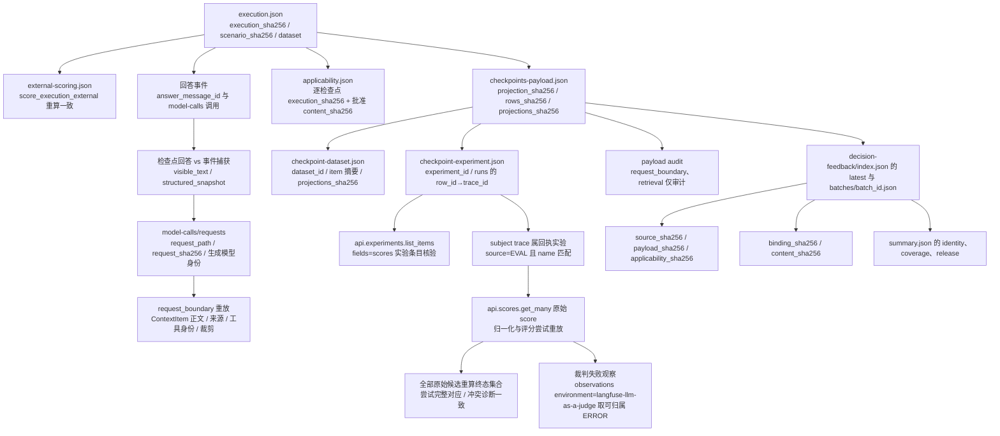

# 外部裁判报告与发布门禁操作手册

## 1. 入口职责

| 入口 | 输入布局 | 用途 |
|---|---|---|
| `evaluation.summary` | `<run>/run.json` + `plan.json` | 本地 Ragas 场景运行的报告与门禁；拒绝 `scoring_mode=external` |
| `evaluation.sdk_summary` | SDK `run.json`（检索）与 `sdk-run.json`（场景） | langfuse 与历史布局的协议分发、综合报告、正式门禁与 `write-v3` |
| `evaluation.decision_feedback` | 外部运行目录 | 反馈回收前离线校验（`check`）与云端读取（`collect`） |
| `evaluation.generation_upload` | 外部运行目录 | 适用性审阅、投影、Langfuse 数据集同步与实验提交 |
| `evaluation.langfuse_scenarios` | 场景 SDK 运行目录 | 外部场景执行、finalize 与运行摘要 |

外部运行只支持 SDK 目录 `<run_id>/sdk-run.json`（schema `fit-agent-scenario-langfuse-1`）。`evaluation.summary` 不读取该布局。

## 2. 产物布局与选择批次

```text
backend/temp/scenario-langfuse/runs/<run_id>/
  sdk-run.json
  scenarios/<example_id>/<scenario_id>/
    execution.json
    external-scoring.json
    external-evaluation.json
  external-judge/
    applicability.review.json
    applicability.json
    checkpoints-payload.json
    coverage-ledger.json
    checkpoint-dataset.json
    checkpoint-experiment.json
    decision-feedback/
      feedback-binding.json
      index.json
      batches/batch-<content_sha256[:16]>.json
```

汇总只读取 `decision-feedback/index.json` 的 `latest` 与对应批次。`latest` 为 `pending` 或 `blocked` 时报告该状态，不回退旧 `complete`。历史批次只用于身份与内容一致性校验。

批次 `complete` 表示所有适用指标已有合法终态，终态可以是 `failed`。`pending` 表示仍有指标待回收或检查点未上传；`blocked` 表示校验阻断；全 N/A 可以 `complete` 且没有检查点裁判实验。

## 3. 离线报告与门禁命令

在仓库根执行：

```powershell
uv run --locked --directory backend python -m evaluation.sdk_summary check --retrieval <retrieval-run> --scenarios <run_id-dir> --dataset backend/dataset/evaluation/rebuild-v3
uv run --locked --directory backend python -m evaluation.sdk_summary report --retrieval <retrieval-run> --scenarios <run_id-dir> --dataset backend/dataset/evaluation/rebuild-v3 --output <output-dir>
uv run --locked --directory backend python -m evaluation.sdk_summary write-v3 --retrieval <retrieval-run> --scenarios <run_id-dir> --dataset backend/dataset/evaluation/rebuild-v3 --output <output-dir> --v3 quantitive-index/v3.md
```

参数：

- `--retrieval`：检索 SDK `run.json`（langfuse 布局 schema 为 `fit-agent-retrieval-langfuse-1`）或其目录。正式发布要求 `purpose=formal`、三组完整、冻结参数与物理索引身份一致。
- `--scenarios`：外部运行目录或其中的 `sdk-run.json`。
- `--dataset`：批准数据版本目录，默认 `backend/dataset/evaluation/rebuild-v3`；外部运行数据身份必须与它一致。显式指定 `rebuild-v1`/`rebuild-v2` 时按各自 80 条基线校验。
- `--scope`：`auto`、`formal`、`validation`，默认 `auto`。定向来源使用 `formal` 仍会阻断。
- `--output`：`report` 与 `write-v3` 的 `summary.json`、`report.md` 输出目录。
- `--v3`：显式指定被更新的文档；文件必须有唯一 `<!-- sdk-summary:start -->` 与 `<!-- sdk-summary:end -->` 标记。

输出：

- `<output-dir>/summary.json`：外部协议使用 `fit-agent-external-judge-summary-langfuse-1`（langfuse 段记录实验/数据集/trace 身份）；Ragas 布局继续使用 `fit-agent-evaluation-summary-1`。
- `<output-dir>/report.md`：外部报告标题为“外部裁判汇总”，Ragas 报告保持原模板。

退出码：

| 命令 | 0 | 1 | 非捕获异常 |
|---|---|---|---|
| `check` | `release.effective=true` | 发布阻断 | 协议或数据无法解析时退出并打印原因 |
| `report` | 文件写入完成 | 不返回 1 | 同上 |
| `write-v3` | 文件写入完成 | 不返回 1 | 标记冲突或协议错误时退出 |

`check` 与 `report` 完全离线，不创建 Langfuse Client，不执行 `collect`、上传、重评分或业务重跑。`write-v3` 只在显式调用时更新目标文件。

## 4. 报告 Schema 关键字段

| 字段 | 内容 |
|---|---|
| `schema` | `fit-agent-external-judge-summary-langfuse-1` |
| `scoring_mode` / `protocol_version` / `feedback_version` | 外部协议身份（`fit-agent-external-scenario-langfuse-protocol-1`） |
| `definitions.metrics` | `evidence_supported_v1`、`reference_requirements_met_v1` 与概率语义 |
| `definitions.aggregation` | 场景内均值、场景间宏平均、两个完整口径与排除规则 |
| `identity` | dataset/code/generation/index、`source_sha256`、`payload_sha256`、`applicability_sha256`、`binding_sha256`、逐行投影摘要、索引/批次、两个实验身份与来源路径 |
| `judge` | Provider、Evaluator、`evaluator_id`、模型别名、配置摘要（含 rule 与变量映射）、问题/评分标准摘要、版本（恒 unreported） |
| `coverage` | 场景/检查点分母、检查点分类计数、每指标计数与维度恒等关系 |
| `generation.metrics` | 每指标预期/适用/N/A/成功/失败/待回收/缺失/阻断/未批准、场景值、两个均值 |
| `execution` / `assertions` | 执行状态、事件/检查点覆盖、上下文缺口、断言统计与缺失检查点 |
| `retrieval` | SDK 检索组别、指标、索引、实验与整体状态 |
| `release` | `effective`、`blocking_issues`、范围/执行/断言/反馈/生成/检索检查项、`quality_reviewed` |

`source_assurance` 固定为 `declared_binding`，并写入限制说明。`unreported` 版本表示 Langfuse score 对象不携带裁判模型版本字段，归档不补造版本。

## 5. 分母、宏平均与阻断

指标预期键来自已批准适用性：`(scenario_id, event_id, checkpoint_id, metric)`。

- 场景内均值：该指标成功检查点分数算术平均。
- 场景间均值：有数值场景的等权宏平均。
- `mean_including_partial`：至少一项成功的场景进入分母。
- `mean_complete_only`：全部适用检查点成功且至少一项成功数值的场景进入分母。
- 全 N/A 场景 `value=null`；失败、缺失、待回收、阻断、未批准项不填 0；真实 0 分进入均值。

阻断条件包括：非正式范围、执行未完成、断言未完整执行或未全部通过、回答未关联真实模型调用、检查点回答正文或结构化快照与事件捕获不一致、请求文件缺失或摘要不符、生成模型身份不符、请求上下文重放不一致、上下文无法绑定、源/代码/索引/模型身份不一致、检查点数据集/实验回执与绑定摘要不一致、原始 score 按生产语义重算后与已保存状态/分数/失败依据/来源身份不一致、评分尝试未完整对应原始候选终态集合、冲突诊断与原始终态集合不一致、最新批次非 `complete`、适用指标存在 `failed`/`pending`/`missing`/`blocked`/`unapproved`、检索三组不完整或检索身份不一致、缺少正式检索来源。

`batch.status=complete` 内含 `failed` 时发布阻断。全 N/A 不提供数值，也不替代执行、断言与检索条件。外部契约没有分数通过阈值；证据与流程门禁满足不代表模型质量达标，未人工审阅时 `quality_reviewed=false`。

## 6. declared_binding 与版本限制

来源保证为显式软链：

- 需要 `feedback-binding.json` 的显式绑定（两指标各一个 evaluator；rule filters 限定检查点 `datasetId`、`isExperimentItemRootSpan=true` 与字符串 metadata 键 `judge_metric_<metric>="applicable"`，采样 1.0；四变量映射 `user_request←Input.user_request`、`answer←Output.answer`、`context←Output.context.items`、`reference←Expected Output.reference`）。
- 成功 score 要求 `source=EVAL`、`name` 匹配声明指标、subject trace 属于回执实验；不适用指标出现对应 score 按意外反馈阻断。
- 不宣称服务唯一证明 Evaluator 身份；Langfuse score 对象不携带裁判模型名与 evaluator 版本，模型版本恒记录为 `unreported`。
- `declared_binding` 与版本未返回都不新增发布阻断；来源缺口、身份冲突、内容漂移、历史冲突、非法分数、缺少云端运行与配置漂移阻断保持不变。
- 一个回收索引固定一套 `feedback-binding.json`。汇总校验每条评分尝试的 Provider、Evaluator、模型别名、配置摘要、问题与评分标准摘要与绑定一致；不同配置的分数不合并。

局部均值、定向场景均值与全 N/A 结果只用于诊断，不能作为正式发布成绩。

## 7. 从执行到报告的身份追溯



每个环节的摘要不一致会在 `check` 或汇总加载阶段阻断，命令不自动修复、不重新上传、不重新评分。

## 8. 真实端到端验收清单

以下环节需要用户另行授权真实模型、Langfuse 与费用；当前全部未执行。

1. 真实执行与确定性断言：
   `uv run --locked --directory backend python -m evaluation.langfuse_scenarios run --purpose formal --scoring-mode external`
   产物：`backend/temp/scenario-langfuse/runs/<run_id>/scenarios/**/execution.json`、`external-scoring.json`。
2. 已批准适用性与脱敏投影：
   `uv run --locked --directory backend python -m evaluation.langfuse_scenarios finalize --run <run_id-dir>`；
   `uv run --locked --directory backend python -m evaluation.generation_upload external-review --source <run_id-dir>`；
   用户填写 `external-judge/applicability.json` 后执行 `external-project`。
   产物：`applicability.json`、`checkpoints-payload.json`、`coverage-ledger.json`。
3. 数据集同步：
   `uv run --locked --directory backend python -m evaluation.generation_upload external-sync --source <run_id-dir>`
   前置条件：`backend/.env` 配置 `LANGFUSE_PUBLIC_KEY` 与 `LANGFUSE_SECRET_KEY`（自建或指定区域另需 `LANGFUSE_BASE_URL`）、用户对数据集写入的授权。
4. 绑定网页裁判：
   在 Langfuse 先建 LLM Connection（自带 provider key），再为检查点数据集配置两项 LLM-as-a-Judge evaluator。每项 evaluator 的 rule filters 同时限定 `isExperimentItemRootSpan=true`、`datasetId` 为 `checkpoint-dataset.json` 的 `dataset_id`、metadata 字符串键 `judge_metric_<metric>="applicable"`，采样率 1.0。变量映射为 `user_request←Input.user_request`、`answer←Output.answer`、`context←Output.context.items`、`reference←Expected Output.reference`；System message 放完整判定标准，User message 放四个变量，score 类型 `NUMERIC` 0..1 并保留 reasoning。按实际配置写入 `decision-feedback/feedback-binding.json`（schema `fit-agent-external-judge-feedback-binding-langfuse-2`）。
5. 授权提交评分：
   `uv run --locked --directory backend python -m evaluation.generation_upload external-submit --source <run_id-dir> --confirm-external-judge-cost`
   前置条件：用户对网页裁判真实模型调用与费用的独立授权。
6. 实际反馈回收：
   `uv run --locked --directory backend python -m evaluation.decision_feedback collect --source <run_id-dir> --wait-seconds 60`
   前置条件：`checkpoint-experiment.json`、匹配的绑定、可用的 Langfuse 凭据。
7. 汇总与检索/重排门禁：
   `uv run --locked --directory backend python -m evaluation.sdk_summary check --retrieval <formal-retrieval-run> --scenarios <run_id-dir> --dataset backend/dataset/evaluation/rebuild-v3 --scope formal`
   前置条件：正式全量 40 场景、正式检索运行与完整身份证据。
8. 人工审阅裁判质量：
   检查两项指标的判定、unreported 版本、冲突与排除记录；`quality_reviewed` 只能由人工审阅确认。

缺少费用授权、凭据、LLM Connection、Evaluator 配置、真实全量运行、正式检索来源或人工审阅时，`release.effective` 保持 `false`，不得宣称真实外部验收或正式发布完成。

## 9. 本轮离线验证记录

2026-10-25 由 subagent 在 `backend/` 目录实际运行（`--basetemp=temp/t7-docs/pytest-*`，单命令 300 秒上限内），全部离线，退出码均为 0。

| 命令 | 结果 |
| --- | --- |
| `uv run --locked python -m pytest test/test_langfuse_retrieval.py -q --basetemp=temp/t7-docs/pytest-t1` | 24 passed，15.33s |
| `uv run --locked python -m pytest test/test_langfuse_scenarios.py test/test_external_scenario_mode.py -q --basetemp=temp/t7-docs/pytest-t2` | 44 passed，53.01s |
| `uv run --locked python -m pytest test/test_external_judge_checkpoints.py -q --basetemp=temp/t7-docs/pytest-t3` | 18 passed，57.30s |
| `uv run --locked python -m pytest test/test_decision_feedback.py -q -k "two_feedback_zero_and_one or invalid_scores or non_numeric_data_type or missing_metric_pending or bounded_wait or real_cloud_failure or remote_run_identity or example_reference or api_and_annotation or duplicate_same_id or different_score_ids or history_conflict or missing_upload or unexpected_feedback or all_not_applicable or read_remote_feedback" --basetemp=temp/t7-docs/pytest-t4a-a` | 22 passed，26 deselected，113.86s |
| `uv run --locked python -m pytest test/test_decision_feedback.py -q -k "check_is_offline or raw_evidence or batch_diagnostics or persistence_idempotent or corrupt_index or binding_rejects or terminal_attempt or malformed_feedback or experiment_receipt_drift or binding_digest_drift or binding_identity_drift or missing_or_pending or payload_projection_drift or feedback_scope or wait_seconds or cli_exit_codes" --basetemp=temp/t7-docs/pytest-t4a-b` | 26 passed，22 deselected，173.46s |
| `uv run --locked python -m pytest test/test_skills_scoring.py test/test_skills_generation.py -q --basetemp=temp/t7-docs/pytest-t5` | 37 passed，18.81s |
| `uv run --locked python -m pytest test/test_external_judge_contracts.py -q --basetemp=temp/t7-docs/pytest-contracts` | 24 passed，8.47s |
| `uv run --locked python -m pytest test/test_retrieval_mteb.py -q --basetemp=temp/t7-docs/pytest-mteb` | 72 passed，96.29s |
| `uv run --locked python -m pytest test/test_retrieval_rerank_evaluation.py test/test_retrieval_review_gate.py -q --basetemp=temp/t7-docs/pytest-rerank` | 34 passed，42.97s |

覆盖数据集同步幂等与冲突恢复、冻结实验提交与远端核验、审阅门禁五处阻断、场景外部模式与 finalize、检查点投影/同步/费用闸门、score 归一化与来源口径、失败观察归属、绑定拒绝、批次持久化与 CLI 退出码、技能数据集命名与裁判直写幂等、检索上传 payload 与回放。测试使用生产加载器、内存鸭子类型 Client 注入与本地封存夹具，未 Mock 云端成功、未伪造全量场景成绩。离线结果不代表真实裁判准确性或正式发布。

T4b 完成后补测：`test_external_summary.py` 全文件 35 passed（含历史 LangSmith 批次最小回归），`test_sdk_summary.py` 26 passed（含 langfuse/历史双布局参数化），`test_evaluation_summary.py` 22 passed、6 deselected，`test_decision_feedback.py` 抽批 12 passed；`ruff` 与 `compileall` 通过。

T8 终态批跑（2026-10-25）：受影响与相邻套件合计 703 passed、0 failed，`test_decision_feedback.py` 按补集拆两批全覆盖，`ruff`、`compileall`、`uv lock --check`、`git diff --check` 全部退出码 0。

P1 缺陷修复批跑（2026-10-25）：同池两组数据集身份冲突、场景入口默认评分模式、冻结上传落库与断点恢复三处修复后，`test_langfuse_retrieval.py` 34 passed、`test_langfuse_scenarios.py` 32 passed、`test_external_scenario_mode.py` 14 passed、`test_retrieval_mteb.py` + `test_retrieval_review_gate.py` + `test_retrieval_rerank_evaluation.py` 106 passed，`ruff`、`compileall` 退出码 0；新增契约见 [评测契约 16.7](evaluation-contracts.md#167-检索上传与场景入口稳定性契约2026-10-25-p1-修复)。

展示投影与网页规则批跑（2026-10-25）：`test_external_judge_checkpoints.py` 18 passed、`test_external_judge_contracts.py` 24 passed、`test_decision_feedback.py` 按互不重叠三批 22+8+18=48 passed、`test_external_summary.py` 24 passed + 10 passed + 历史 LangSmith 夹具修正后 1 passed、`test_sdk_summary.py` 26 passed、`test_evaluation_summary.py` 28 passed；`ruff`、`compileall`、`uv lock --check`、`git diff --check` 退出码 0。详细命令与耗时见 [评测契约 16.8.5](evaluation-contracts.md#1685-本轮验证)。

## 10. 本轮未运行项

- Langfuse 云端全链路：真实 `langfuse_retrieval`/`langfuse_scenarios` 云端 sync/run、`external-sync`/`external-submit`、真实 `collect`、网页 evaluator 触发与分数回读。阻塞项：`backend/.env` 已有 `LANGFUSE_PUBLIC_KEY`/`LANGFUSE_SECRET_KEY`/`LANGFUSE_BASE_URL` 条目（值未读取、未打印），当前进程环境未设置；未建立 Langfuse 项目与 LLM Connection、无网页访问与 Evaluator 身份、未获得数据集写入/实验提交/裁判费用授权。
- 诊断运行 `20261025T064301Z-9f370396` 已记录用户批准的 `external-judge/applicability.json`（`approval.content_sha256=ca67a6e42e805cde5d60b7033bc1ac6e0b1f4830498731465a714ed2613e6a15`），`external-project` 退出码 0，`external-sync` 创建检查点数据集 `fit-agent-external-judge-langfuse-v2-20261025T064301Z-9f370396-ca67a6e42e80`（ID `cmvnklfix00c7ad0f5dj6bqkz`，5 个样例，页面 `https://us.cloud.langfuse.com/project/cmvn966q7002fad0ea2ivxc7o/datasets/cmvnklfix00c7ad0f5dj6bqkz`）。覆盖为 `uploadable` 5、`missing` 4、`not_applicable` 6、`pending_review` 0。检查点实验尚未提交。
- 场景级实验保留真实故障：远端 metadata `feedback_version` 不符、确定性 score 未回读、历史 HTTP 429、3 个 blocked 场景缺少生成检查点或断言绑定错误。投影调整未掩盖这些故障。
- reranker/Cross-Encoder 专项与真实服务测试：`test_retrieval_rerank_stages.py`、`test_retrieval_rrf.py`、`test_retrieval_stages.py`、`test_retrieval_runtime_integration.py`、`check_retrieval_rerank_production.py` 等。
- 真实生成模型、Embedding、reranker、裁判模型调用与正式成绩更新。
- 真实 40 场景外部全量运行、正式检索来源与人工裁判质量审阅。
