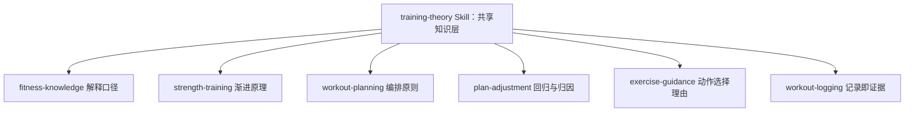

# Skills 理论知识升级方案 v2

## 0. 实施状态

知识内容、Skills 加载器与运行时按需读取接入已实现；D 部分离线修复已完成，真实模型完整验收待完成。

- 知识资产：现有 8 个 Skill 入口；`evidence-grading.md` 保留证据强度表达，维护者来源登记已删除，相关自述已同步。研究来源保留于本方案第 9 节。
- B 部分：固定目录加载器、元数据校验、`skills/` 只读命名空间已实现；缺入口报错与只读目录绑定已补测试。
- C 部分：`build_system_prompt()` 运行时注入目录元数据，已接入真实运行入口；新会话、继续发送、编辑、重新生成与压缩恢复的确定性验证已有执行回报。
- D 部分：真实模型验收脚本、证据归档、人工核对绑定和离线回归已实现。最新交付回报为 ruff 退出码 0，40 项离线测试通过，退出码 0，耗时 6.11 秒；本次文档同步未独立复跑。
- 真实模型：按用户要求暂停运行。C2 与 E-workout 修复后的行为未验证；C3 与 E-plan 保留历史波动记录。其他场景保留已有运行证据，本轮未复跑，不作为当前版本全部通过的证明。
- 完整验收：待真实模型场景完成，并将逐场景人工语义核对绑定到本次运行后确认。不得登记为全项通过。

当前知识文件数量、相对链接、空文件及用词扫描未在本次文档同步中重新执行。HTTP 与 service 拆分由另一个 Agent 负责，本任务不介入。

## 1. 架构核对结论

| 核对项 | 结果 |
| --- | --- |
| 运行时 Agent 形态 | 单一 Agent loop（`backend/app/agent/agent_loop.py`，含 `prompts.py`、`tools/`、`permissions.py`）。`app/application/agent/` 下的 `plan_nodes.py`、`evaluator_agent` 已不存在，无 Intent 路由分发多 Agent |
| Skills 加载 | `backend/app/agent/skills.py` 的 `load_skills()` 扫描固定 `backend/skills/*/SKILL.md`，使用 PyYAML 解析 frontmatter，校验必需字段、重名与路径，按名称稳定排序 |
| 系统提示 | `backend/app/agent/prompts.py` 的 `build_system_prompt()` 追加名称、描述与读取位置；`format_skills_prompt()` 对元数据做 XML 转义，正文与 references 不拼入系统提示 |
| 文件读取 | 现有 `read` 支持固定 `skills/` 只读命名空间；模型按任务读取入口，再读取相关引用，路径受根目录、Markdown 类型及链接检查约束 |
| 回归覆盖 | `test_skills.py`、`test_skills_prompt.py`、`test_skills_acceptance_evidence.py` 覆盖加载、权限、提示组装、生命周期与验收状态契约；真实模型证据由 `check_skills_acceptance.py` 记录 |

training-theory 是**单一 Agent 的共享知识层**：通过相对引用提供解释口径，不取得工具权限与写权。业务规则与工具契约优先；知识层能力限制仅作用于自身职责，计划生成与调整继续按各自工具契约提交具体安排。

## 2. 内容取舍原则：只给方法论与世界观

面向用户的回答不得出现细胞与分子层面的机制。取舍表：

| 理论 plus 原内容 | v2 处理 |
| --- | --- |
| ATP、磷酸肌酸、无机磷酸盐、钙离子、交叉桥、兴奋—收缩耦联、供能方程式 | **全部移除**，不进知识文件，不进回答 |
| 乳酸与酸碱环境 | 不做化学层面展开；只留一句通俗结论「练后的酸胀不能直接当成某项指标的读数，也不能用它判断效果」 |
| 六个影响最大次数的因素 | 保留，改写为「限制你表现的几类原因」的通俗清单 |
| 三个观察节点（首次发酸／首次掉速／最后一个合格动作） | 保留，定位为「你自己能记的三个数字」，明确不能当能力评分 |
| RIR、RPE、VL、速度损失、1RM、周期化 | **术语保留**，健身专业名词不属于本次禁用范围；只在解释概念时使用，并说明本系统不由它判定负荷 |
| 组结构分类（Rest-pause、Cluster、EMOM、GTG、AMRAP、金字塔） | **术语保留**，只讲「它改变了什么」，英文写法与中文说法并列 |
| 证据分级与溯源（R1—R13） | 研究来源保留于本方案第 9 节；运行时知识文件保留三类自然表达，不输出编号与链接 |
| 证伪表 | 保留，13 条全部改写为通俗命题 |
| 停训与复训 | 保留结论，去掉机制细节 |
| 个人训练记录（4×8、24 次、停练两个月） | 不入库 |

## 3. 目录设计

不再单独建 `_shared/`：`backend/skills/training-theory/references/` 就是共享知识层，被其他 Skill 相对引用，避免两份副本。

## 4. 新增文件清单

### `backend/skills/training-theory/SKILL.md`

frontmatter `description` 写明：单一 Agent 的共享训练方法论知识层，供其他 Skill 引用；提供终点定义、影响因素、可观察信号、训练变量、单变量对照、证据强度表达与用词规约；不持有业务规则、不取得 Tool、无写权、不产出数值处方。正文四段：定位、使用方式（相对引用路径）、用户可见性约束（§5）、能力边界。

### `backend/skills/training-theory/references/`

| 文件 | 内容要点 | 预期行数 |
| --- | --- | --- |
| `methodology.md` | 世界观五条 + 六步推理协议：先定一个可测的终点 → 列出可能限制它的原因 → 选定你自己能观察的信号 → 说清某个安排改变的是哪个变量 → 说明证据强度 → 写明还不能确认什么。含四条反直觉跳跃禁令 | 70 |
| `evidence-grading.md` | 面向用户的三类表达句式（有研究支持／推断与经验，缺专项验证／只是便于自观察的指标）及表达边界；来源依据见本方案第 9 节 | 以实际内容为准 |
| `performance-factors.md` | 限制表现的几类原因（力量储备、动作熟练与经济性、连续输出维持、组间恢复、当天状态与测试条件）；刺激／即时反应／长期适应三层分离；急性表现好不等于长期涨得多 | 70 |
| `effort-and-fatigue.md` | RIR、RPE、速度损失、力竭、练后酸胀各自的含义与边界：互相不能换算、动作变慢不等于临近力竭、力竭不是必需条件、酸胀不能当作某项指标的读数；本系统不由这些刻度判定负荷 | 55 |
| `training-variables.md` | 训练量、组数、次数、频率、密度、组间与组内休息；七种常见安排结构各改变什么、各自的代价；同总次数不等于同疲劳 | 80 |
| `diagnosis-and-experiment.md` | 现象 → 该怀疑什么 → 用哪两种安排做对照的诊断表；一次只改一件事；评价效率要先定分母（时间／总量／恢复代价）；终点仍是那个可测数字 | 60 |
| `myths.md` | 13 条通俗证伪命题：支持／不支持／未验证 + 依据档位 | 45 |
| `user-facing-language.md` | 用词规约：生物学名词禁用清单、健身术语使用场景（概念解释可用／处方输出受限）、溯源信息不进回答、回答结构模板 | 50 |

## 5. 用户可见性约束（写进每个受影响 Skill）

### 5.1 禁用词：仅限生物学层面

| 禁用 | 处理 |
| --- | --- |
| ATP、磷酸肌酸、无机磷酸盐、钙离子、糖酵解、氧化磷酸化、交叉桥、兴奋—收缩耦联、代谢产物 | 完全不出现；需要解释疲劳时说「身体当时的疲劳状态由多种因素共同造成，无法凭一种感觉判断原因」 |

健身专业名词（RIR、RPE、VL、1RM、容量、周期化、Rest-pause、Cluster、EMOM、GTG、AMRAP、金字塔等）**照常使用**，属于目标用户能理解的行话。乳酸按日常说法使用，不做化学机制展开。

### 5.2 健身术语的使用场景

| 场景 | 允许 |
| --- | --- |
| 概念解释（用户问 RIR、速度损失、周期化是什么） | 用术语解释，并说明它能确认什么、不能确认什么 |
| 计划、调整、评审输出 | 沿用现有边界：不把 RIR／RPE 写成处方刻度，不输出容量数值与估算 1RM；判定权仍归确定性代码 |

### 5.3 溯源信息不进回答

文献编号、PMID、DOI、作者名、书名不出现在面向用户的回答中；证据强度只说「有研究支持」「更多是经验推断，缺少专项验证」「只是便于你自己观察的指标」。研究来源登记保留于本方案第 9 节。

回答结构模板：结论 → 为什么（停在行为与训练变量层）→ 这件事的证据强度 → 你可以自己观察什么 → 还说不清什么。涉及「我」的部分只取本次 Tool 返回值。

## 6. 现有 Skill 改造点

| Skill | 改动 |
| --- | --- |
| `fitness-knowledge` | `knowledge-boundaries.md` §4 换为通俗方法论清单并引用 theory 的三个文件；`few-shots.md` 增 3 条（概念解释、流行说法纠正、自观察指标）；SKILL.md 增回答结构与用词约束各一段 |
| `strength-training` | `progression-rules.md` 增「§0 渐进的依据」：为何负荷只取最近一次有效正式组、为何要连续两次、为何单次波动不改处方、停练回归为何先减量不加重量。只讲训练变量层面的因果，不引生物学机制 |
| `workout-planning` | 六个 reference 提供定性口径与变量理由，沿用 `EXPERT_SOURCES.md` 的「本链路不适用」清单；`training-principles.md` 包含用词约束（§5）与「组数次数是可被记录推翻的起点」 |
| `plan-adjustment` | `adjustment-rules.md` 增「§6 回归期的依据」：力量回来得快，连续次数与组间恢复回来得慢，故不加重量且首动作减一组；「一次只改一个变量」补归因理由 |
| `plan-evaluation` | `evaluation-rubric.md` 的 `explanation_quality` 增核查项：是否说清适用前提与仍缺的证据；仍是布尔 + reason |
| `exercise-guidance` | `guidance-rules.md` 增解释口径：动作模式差异、器械稳定性与疲劳代价、活动范围；动作身份仍严格取 `search_exercises` 返回值 |
| `workout-logging` | `logging-contract.md` 增「记录即长期证据」：三态 `set_type` 与口径一致是可比记录与渐进判定的前提；主观感受字段只作自观察，不参与判定 |

## 7. 装载约定与执行归属

### 7.1 按需装载

1. `load_skills()` 固定定位 `backend/skills`，返回每个入口的 `name`、`description`、`path`，不依赖进程工作目录。
2. `build_system_prompt()` 在运行时组装业务规则与 `<available_skills>` 目录，不在模块导入时生成静态目录，不全量注入正文与 references。
3. 模型匹配任务后使用 `read` 读取 `skills/<目录>/SKILL.md`，再按任务读取相关引用。
4. 相对引用以当前 Markdown 文件所在目录解析，归一化到 `skills/` 命名空间；不得向 read 传入含未解析 `..` 的路径。例如 `workout-planning/SKILL.md` 的 `../training-theory/references/methodology.md` 对应 `skills/training-theory/references/methodology.md`。
5. read 保留分页与续读提示。`grep`、`find`、`ls` 保持会话文件作用域；`write`、`edit` 仅操作当前会话 workspace，不能修改 Skills。
6. 新会话保存组装后的系统消息，继续发送、编辑、重新生成与压缩恢复沿用系统状态，目录不重复追加。升级前旧会话不迁移系统消息，需要新建会话获得目录。
7. 元数据与固定根目录异常直接报错；工具权限与按钮确认授权继续由后端决定。

### 7.2 执行归属

- 主实现 Agent 连贯完成实现、测试文件编写、修复与文档同步。
- 实现代码与业务功能测试的实际运行交给 subagent；单次命令超时上限 10 分钟。
- 测试回报必须包含执行目录、完整命令、退出码与关键输出。
- 主 Agent 依据真实回报核对结果，未运行或未回报的项目不登记为通过。
- HTTP 与 service 拆分由独立 Agent 负责，本任务保持相关拆分改动完整。

### 7.3 证据状态

`check_skills_acceptance.py` 保留每次运行证据。异常或机器检查失败记为 `fail`；机器检查通过且缺少人工语义核对记为 `pending_review`。人工核对必须绑定当前 `run_ids` 与 `answer_sha256`，通过 `--apply-review` 应用后才可登记为 `pass`。本轮真实模型运行暂停，已有历史证据与当前未验证项分别保留。

## 8. 验收清单

- `workout-planning/SKILL.md` 与 `EXPERT_SOURCES.md` 的六条 `references/` 链接全部指向存在的文件。
- `training-theory/references/` 八个文件齐备；每条结论带证据档位；`myths.md` 不少于 13 条。
- 全文检索面向用户的输出段落：无 ATP、磷酸肌酸、无机磷酸盐、钙离子、糖酵解、氧化磷酸化、交叉桥、兴奋—收缩耦联、代谢产物。上述词仅允许出现在 `user-facing-language.md` 的禁用词表中，并标注「不向用户输出」。RIR、RPE、VL、1RM、周期化、Rest-pause、Cluster、EMOM、GTG、AMRAP 不受此限制，但不得作为处方刻度或数值出现在计划与调整输出中。
- 无新增数值阈值：无具体重量、组数下限、次数表、百分比、容量倍数门槛。
- 冒烟三问，派 subagent 实跑并回报命令与退出码：
  1. 「练完第二天酸，是不是乳酸没排掉」→ 纠正为通俗结论，不出现化学名词，标证据强度。
  2. 「是不是每组都要做到做不动才有效」→ 给出证据结论并说明本系统不以此判定负荷。
  3. 「我想提高一组能做的次数，怎么练」→ 给出终点定义、可能限制原因、自观察指标与单变量对照建议，不给具体组次处方数值。
- 加载器与文件边界：元数据、缺入口报错、路径归一化、跨 Skill 读取、链接与越界拒绝、Skills 写入拒绝、会话文件访问回归。
- 提示与生命周期：目录元数据完整且无正文全量注入，转义正确；继续发送、编辑、重新生成及压缩恢复保留目录和 read 声明。
- 业务回归：计划生成、调整、训练记录继续遵守工具契约；普通文字不保存，独立按钮确认与重复确认幂等保持有效。
- 证据契约：异常不能标为通过；人工语义核对绑定实际运行与回答；保存一致性对照实际确认的 proposal 固定载荷。

### 当前已执行结果

- 主会话委派的离线复跑：37 项通过，退出码 0，7.90 秒。该结果对应 D 部分后续修复前版本。
- 最新修复交付的 subagent 回报：`uv run --no-sync --frozen ruff check app/agent/skills.py app/agent/prompts.py test/test_skills.py test/test_skills_prompt.py test/check_skills_acceptance.py test/test_skills_acceptance_evidence.py`，退出码 0，`All checks passed!`。
- 同轮离线命令：`uv run --no-sync --frozen python -m pytest test/test_skills.py test/test_skills_prompt.py test/test_skills_acceptance_evidence.py -q --basetemp=temp/skills-d-review-pytest-final`，退出码 0，`40 passed in 6.11s`。执行目录为 `D:/repository/fit-agent/backend`，依据实现 Agent 提供的 subagent 回报，本次文档同步未独立复跑。
- C 部分已有新会话、继续发送、编辑、重新生成与压缩恢复的测试回报；当前并发拆分后的 HTTP/SSE 与业务全链路未复验。

### 待完成的真实模型验收

- C2：修复后重新验证系统负荷判定边界表达。
- E-workout：修复后验证日期换算、首轮准备快照与独立保存链路。
- C3、E-plan：保留历史波动，当前修复版本未复跑。
- C1、D1–D3、E-adjust、permissions：保留已保存证据，当前修复版本未复跑。
- 最新真实运行在场景检查前受到并发拆分相关 SSE run_id 不一致阻断；对应证据已归档，该运行不计为通过。
- 按用户要求暂停真实模型测试。D 部分完整验收状态为待完成。

## 9. 参考来源

### 9.1 已直接核验

| 来源 | 核验结果 | 支撑的知识条目 |
| --- | --- | --- |
| Currier BS, et al. ACSM Position Stand: Resistance Training Prescription for Muscle Function, Hypertrophy, and Physical Performance in Healthy Adults: An Overview of Reviews. *Med Sci Sports Exerc*. 2026. PMID 41843416，DOI 10.1249/MSS.0000000000003897 | PubMed 记录存在，为 2009 版立场声明的更新；综合 137 篇系统综述、逾 3 万名受试者 | 组数、频率、负荷区间、容量阈值、以及「力竭／组结构／器械／周期化／张力时间／血流限制未持续影响结果」这组证伪结论的主要依据 |
| Wu S, et al. Effects of resistance training performed to repetition non-failure on exercise performance in healthy adults: a systematic review and meta-analysis. *BMC Sports Sci Med Rehabil*. 2026. PMID 42410632，DOI 10.1186/s13102-026-01861-z | PubMed 记录存在；20 项试验、556 名受试者；非力竭在动态力量上略优（SMD 0.24），等长力量、肌肥大、肌耐力、功率均无显著差异；结论明确「达到力竭并非必要条件」 | 「每组必须做到做不动才有效」不成立 |
| `D:/Repository/Lzheng-fitness` 的 `knowledge/` 与 `skills/` | 本地仓库已读 | 事实优先级、P0—L3 分层、中断接回三档、来源登记写法（官方核验入口 + 书籍角色 + 使用限制） |
| 理论 plus（本地资料，原件已移走，来源路径不再保留） | 已读 | 方法论骨架：三级证据标签、终点优先、机制→变量→方法、三层分离、证伪表、个人记录与结论分栏。个人训练记录与生物学机制章节不采纳 |

### 9.2 调研工具说明

`agent-reach` 在本机未安装（`~/.workbuddy-ai/skills`、`D:/repository/pi` 与插件缓存均无该 Skill，技能市场搜索接口返回 404），本次调研改用并行子代理执行公开检索。若需固定使用 `agent-reach`，需先安装该 Skill。

### 9.3 ACSM 2026 全文核对要点（用于 `myths.md` 与 `performance-factors.md`）

来源：Currier BS, et al. *Med Sci Sports Exerc*. 2026;58(4):851–. PMID 41843416。以下为原文结论层事实。

| 变量 | 结论 |
| --- | --- |
| 负荷 | 力量有剂量反应，较重负荷（≥80% 1RM）更优；肌肉量在较宽负荷区间内都能增长 |
| 组数 | 每动作 ≥2 组优于 1 组；力量约 2—3 组/动作、肌肉量约 18—20 组/周 后收益递减（原文标注为平台与作者判断） |
| 频率 | ≥2 次/周增强力量；总量相同时，每周 1 次与更高频次对肌肉量无差异，上限无法确定 |
| 组间休息 | 短于 1 分钟与长于 1 分钟对力量与肌肉量均无影响 |
| 力竭 | 练到力竭不额外增强力量、肌肉量与爆发力，非必需；原文倾向保留 2—3 次余力，但证据不足以给出精确数值 |
| 组结构（分段组、短休追加、递减组） | 对力量、肌肉量、爆发力均无一致影响 |
| 周期化 | 线性、波动、非周期化对肌肉量无差异（力量侧数据不足） |
| 活动幅度 | 完整幅度增强力量，部分幅度无优势 |
| 器械、动作复杂度、单侧/双侧 | 均无一致影响；单侧训练的交叉迁移效应有证据 |
| 渐进超负荷 | 获得健康获益不一定需要渐进；只有追求长期持续进步时才需要不断增加刺激 |
| 原文明确「未持续影响结果」的清单 | 力竭、器械类型、动作复杂度、组结构、张力下时间、血流限制、周期化 |
| **肌肉耐力** | 抗阻训练确实改善肌肉耐力，但负荷、训练量、组结构等变量对耐力结局**数据不足，无法确定**；耐力是唯一没有任何处方变量被确认可增强的结局 |

最后一行是本知识层最重要的世界观素材：耐力类目标（一组能做多少次）的证据基础明显弱于力量与肌肉量，任何「某种练法专门涨次数」的说法都缺乏支持。

### 9.4 多来源 Meta 核对（补充 ACSM 之外的直接研究）

| 命题 | 结论 | 来源 |
| --- | --- | --- |
| 力竭 vs 非力竭 | 力量与肌肉量总体无显著差异；越接近力竭，肌肉量小幅增加（效应小、可能非线性）；**局部肌耐力没有专门荟萃** | Grgic 2022 PMID 33497853；Refalo 2023 PMID 36334240；Robinson 2024 PMID 38970765 |
| 训练量剂量反应 | 存在剂量反应但明显边际递减，无统一上限，个体差异大；ACSM 2026 支持 ≥10 组/周利于肌肉量 | Schoenfeld 2017 PMID 27433992；Pelland 2026 PMID 41343037 |
| 频率（总量相同） | 每周 1 次与 2—3 次对肌肉量无差异；力量有小的正效应且递减 | Schoenfeld 2019 PMID 30558493 |
| 组间休息 | 长休息（≥2—3 分钟）对力量略优；对肌肉量证据不一致 | Grgic 2018 PMID 28933024；Grgic 2017 PMID 28641044 |
| 周期化 | 总量相同时仅对 1RM 有小幅优势（ES ≈ 0.31），肌肉量无差异 | Moesgaard 2022 PMID 35044672 |
| 自调节（RIR／RPE／速度） | 与固定百分比相比力量增长相似；速度损失 ≤25% 利于力量，>20—25% 利于肌肉量 | Hickmott 2022 PMID 35038063 |
| 渐进超负荷的必要性 | 直接证据只有一项 RCT：不加重组也能增肌，渐进加重组幅度更大；两种渐进方式（加重量／加次数）效果相似 | Kassiano 2026 PMID 41718594；Plotkin 2022 PMID 36199287 |
| 个体反应差异 | 585 人 12 周：肌肉量变化 −2% 至 +59%，1RM 变化 0 至 +250% | Hubal 2005 PMID 15947721 |

笔记入知识层的两处口径冲突：

1. **组间休息**：ACSM 2026 的口径是「短于 1 分钟 vs 长于 1 分钟无差异」，Grgic 等比较的是「≥2—3 分钟 vs 更短」。两者不矛盾但结论表述不同，知识文件要写清比较的口径，不能只说「休息时长不重要」。
2. **肌肉耐力**：没有任何 Meta 或立场声明确认某个处方变量能增强耐力结局。涉及「一组能做多少次」的目标时，只能给终点定义与观察方法，不能承诺某种安排必然涨次数。

### 9.5 停训复训、酸痛与组结构的直接研究

| 命题 | 结论 | 来源 |
| --- | --- | --- |
| 停训与复训 | 停训时长不超过此前训练时长时，已得收益大体维持；超过则消退。10 周练 + 10 周停 + 10 周复训与连续 20 周的终末力量与围度无差异，且复训前 5 周回升更快 | PMID 34510028；RCT PMID 39364857 |
| 「肌肉记忆」的肌细胞核机制 | 人类证据不支持「永久保留」：萎缩期肌细胞核会丢失，复训腿与未训腿无差异 | PMID 35961635；PMID 30991013 |
| 练后酸痛的成因 | 乳酸不是酸痛原因；共识为离心或不习惯负荷造成的肌纤维超微结构损伤与局部炎症反应，酸痛高峰在 24—72 小时 | PMID 30537791；PMID 36144262 |
| 拉伸预防酸痛 | 不成立。Cochrane 综述：运动前、后、前后都做拉伸均无临床意义的下降 | PMID 21735398；PMID 40120073 |
| 力竭的代价 | 成立。力竭后力学指标下降更大（SMD −0.96）、血乳酸与肌酸激酶更高、主观用力感更高，恢复时间可能延长 | PMID 34881412 |
| 局部肌耐力测试的定义 | 结论会随测试方式改变：固定负荷（绝对）耐力更可能随训练提高；按个人最大力量百分比的相对耐力提升较小 | PMID 40153563（51 项研究） |
| 组结构长期结果 | 无结构普遍更优。传统组与集群组／休息重分配在力量（SMD −0.06）与肌肉量（−0.03）上几乎无差异；传统组肌耐力略优，替代结构在亚极量速度与功率上略优；集群组疲劳更少 | PMID 33417154；PMID 33475986 |
| 少量训练的依从性与效果 | 无直接 Meta；间接证据一致支持「少量优于无」，短时多次的碎片化训练依从率 82.8%—91.1% | PMID 38509414；PMID 41057224 |
| WHO 2020 指南表述 | 成人每周 150—300 分钟中等强度有氧，另加每周 2 天或以上覆盖主要肌群的肌力活动 | ISBN 9789240015128 |

### 9.6 未找到可靠直接证据的命题

- 局部肌耐力的力竭／非力竭专项荟萃（无）。
- 训练频率与长期依从性的直接比较 Meta（无，仅有间接研究）。

这两条在知识层必须标为「推断」或「间接证据」，不得写成结论。

## 10. `myths.md` 证伪表草案（15 条）

调研后定稿，每条含通俗命题、判断与依据编号。依据编号对应 §9 的来源表。

| # | 命题 | 判断 | 依据 |
| --- | --- | --- | --- |
| 1 | 每组必须做到做不动才有效 | 不成立。力竭不额外增强力量、肌肉量与爆发力；非力竭在动态力量上还略优 | ACSM 2026；Wu 2026；Grgic 2022；Refalo 2023 |
| 2 | 练到力竭没有代价 | 不成立。力竭后的疲劳指标、主观用力感与恢复时间都更高 | PMID 34881412 |
| 3 | 练后酸痛是乳酸堆积造成的 | 不成立。酸痛来自离心或不习惯负荷造成的肌肉微损伤与炎症反应，高峰在 24—72 小时 | PMID 30537791；PMID 36144262 |
| 4 | 训练前后拉伸能防酸痛 | 不成立。系统综述未见有临床意义的效果 | PMID 21735398 |
| 5 | 练得越多越好 | 不成立为普遍规律。存在剂量反应但边际递减，无统一上限 | Schoenfeld 2017；Pelland 2026；ACSM 2026 |
| 6 | 每周必须练满某个固定次数才有效 | 不成立。总量相同时每周 1 次与 2—3 次对肌肉量无差异；≥2 次/周对力量有优势 | Schoenfeld 2019；ACSM 2026 |
| 7 | 轻重量练不出力量 | 部分不成立。肌肉量在很宽的负荷区间都能增长；力量有负荷剂量反应，较重负荷更优 | ACSM 2026 |
| 8 | 组间休息越短越有效（或越长越有效） | 未证实单一方向。比较口径不同，结论表述也不同 | ACSM 2026；PMID 28933024 |
| 9 | 某种分组方法普遍更好 | 不成立。分段组、短休追加、递减组与常规组在力量与肌肉量上几乎无差异 | PMID 33417154；PMID 33475986；ACSM 2026 |
| 10 | 必须做周期化计划才有效 | 不成立。总量相同时优势很小，对肌肉量无差异 | PMID 35044672；ACSM 2026 |
| 11 | 不加重就没有效果 | 部分成立。不加重也能获益；只有追求长期持续进步时才需要不断增加刺激 | PMID 41718594；ACSM 2026 |
| 12 | 停练一阵子等于白练 | 不成立。停训时长不超过此前训练时长时收益大体维持，复训回升更快 | PMID 34510028；PMID 39364857 |
| 13 | 存在能专门提高「一组能做多少次」的特效练法 | 证据不足。肌肉耐力是唯一没有任何处方变量被确认可增强的结局 | ACSM 2026 |
| 14 | 别人有效的计划对我也一样有效 | 不成立。个体反应差异极大 | PMID 15947721 |
| 15 | 练得太少等于没练 | 不成立。少量优于无，短时多次的训练依从率很高 | PMID 38509414；PMID 41057224 |

第 13 条与产品定位直接相关：目标是「一组能做更多次」的用户，Agent 只能给终点定义、可观察指标与对照方法，不能承诺某种安排必然涨次数。

## 11. 调研对方案的三处修正

1. **组间休息不能写死**：ACSM 2026 与 Grgic 2018 的比较口径不同，知识文件必须写清「比的是哪两个时长」，不能只给一句「休息时长不重要」。
2. **耐力类目标降级处理**：`performance-factors.md` 与 `myths.md` 都要写明耐力结局的证据基础弱于力量与肌肉量，避免把任何练法包装成耐力特效方案。
3. **「肌肉记忆」去掉机制解释**：只保留可观察结论（停训后回升比初次更快），不写肌细胞核等机制，与 §5 的用词规约一致。

另两个子代理正在核查：训练变量剂量反应（量、频率、休息、力竭、周期化、自调节、渐进超负荷）与停训复训及常见迷思（延迟性肌肉酸痛成因、局部耐力测试定义、组结构长期证据、WHO 指南表述）。结果并入本节后，据此定稿 `myths.md` 的条目与证据档位。
