# 训练专业知识库整理方案

## 0. 当前状态

- 知识资产：单一入口 `backend/skills/training-theory/SKILL.md`，正文只有主题索引与读取路径；主题正文在
  `references/` 下，共 15 个文件。原有其余七个 Skill 目录已完整删除，`skills/` 下只有 `training-theory`。
- 加载器：未改动。`load_skills()` 仍扫描固定 `backend/skills/*/SKILL.md`，校验 frontmatter、重名、路径与
  链接；缺入口直接报错。
- 系统提示：只注入该 Skill 的名称、描述与入口路径，正文与 references 不拼入。按需 read、相对引用归一化、
  分页续读、`skills/` 只读隔离均保持原有语义。
- 离线验收：`ruff` 退出码 0；`pytest test/test_skills.py test/test_skills_prompt.py
  test/test_skills_acceptance_evidence.py` 44 项通过，退出码 0。命令与执行目录见第 5 节。
- 审计修复：复训不再以停训时长支撑保留原重量；用户明确给出的重量按原值采用；验收脚本已删除生物学禁词、
  系统负荷声明与数值处方三组断言；D1 语义检查改用完整读取内容；耐力证据缺口限定到对应综述的范围。
- 真实模型验收：按用户要求暂停，本轮未运行。知识专业化效果与真实模型表现登记为未验证。
- 旧会话：系统消息已保存为旧版本，可能继续引用旧目录。新目录适用于新建会话；本次不提供历史会话迁移、
  路径别名或兼容机制。

## 1. 结构与加载

```mermaid
flowchart TD
    S[skills/training-theory/SKILL.md 主题索引] --> M[methodology 分析原则]
    S --> E[evidence-grading 证据强度]
    S --> R[sources 来源登记]
    S --> P[performance-factors 表现限制]
    S --> F[effort-and-fatigue 努力与疲劳]
    S --> V[training-variables 训练变量]
    S --> G[progression 渐进与记录]
    S --> GC[goal-content 目标侧重]
    S --> T[trainee-classification 训练者差异]
    S --> PD[program-design 编排与计划分析]
    S --> ET[exercise-technique 动作技术]
    S --> ES[exercise-selection 动作选择]
    S --> A[adjustment 停滞与调整]
    S --> D[diagnosis-and-experiment 诊断与对照]
    S --> MY[myths 常见说法]
```

装载约定：

1. `load_skills()` 固定定位 `backend/skills`，按名称稳定排序，不依赖进程工作目录。
2. `build_system_prompt()` 运行时组装业务规则与 `<available_skills>` 目录，不全量注入正文与 references。
3. 模型按任务读取 `skills/training-theory/SKILL.md`，依主题索引选择文件；需要背景时再读关联文件。
4. 相对引用以当前文件所在目录解析，归一化到 `skills/` 命名空间。`SKILL.md` 里的
   `references/adjustment.md` 对应 `skills/training-theory/references/adjustment.md`。
5. read 保留分页与续读提示；`write`、`edit` 只作用于当前会话 workspace，不能修改 Skills。
6. 元数据与固定根目录异常直接报错；工具权限与确认授权仍由后端决定。

## 2. 内容归属

原八个入口的专业知识合并为单入口后，各旧 Skill 的独有内容落点如下。

| 旧入口 | 保留的独有知识 | 落点 |
| --- | --- | --- |
| `training-theory` | 分析原则、证据档位、表现限制、努力与疲劳、训练变量、诊断对照、证伪表 | `methodology.md`、`evidence-grading.md`、`performance-factors.md`、`effort-and-fatigue.md`、`training-variables.md`、`diagnosis-and-experiment.md`、`myths.md` |
| `strength-training` | 渐进依据、专项性、可比记录、负荷来源、个体差异、回归期做法与三条记录类示例 | `progression.md` |
| `fitness-knowledge` | 一般训练原则、事实与未知的处理、五条教育性示例（器械比较、查历史记录、酸痛、力竭、提高次数） | `program-design.md`（通用原则）、`progression.md`（读历史记录）、`myths.md`、`effort-and-fatigue.md`、`performance-factors.md` |
| `exercise-guidance` | 动作模式差别、稳定性与疲劳代价、活动范围、技术要点、重量口径含义、三条口径示例 | `exercise-technique.md` |
| `workout-planning` | 目标侧重、训练者分层、动作选择与起点优先级、传统硬拉准入、替代与回退、频率与训练日、变量分配、来源登记 | `goal-content.md`、`trainee-classification.md`、`exercise-selection.md`、`program-design.md`、`sources.md` |
| `plan-adjustment` | 变化来源归因、可调整对象与依据、单变量调整的适用条件与局限、保守复训、变量取舍、验证方法、三条调整示例 | `adjustment.md` |
| `plan-evaluation` | 目标匹配、安排合理性、依据与解释三个检查角度及四个结论示例 | `program-design.md` 第二节 |
| `workout-logging` | 记录可比性、主观反馈的定位、记录作为长期证据 | `progression.md`、`performance-factors.md` |

示例按主题就近安放，没有集中成大文件。工具参数、返回字段、载荷结构与状态枚举不进入知识库，仍由工具
声明与参数模型承载。

## 3. 已删除内容

- 角色与权限声明：无处方权、无写权、只能解释工具事实、单一 Agent 角色划分、能力边界清单。
- 接口手册：工具白名单、完整参数与返回字段清单、JSON null 写法、版本号与状态枚举、按钮确认与提案状态
  流程、HTTP 保存说明。
- 重复的全局声明：单一 Agent 身份说明、每份文件都复述的安全提示与写入边界。
- 知识层禁令：禁止讲机制、禁止给出作者与研究来源、禁止讨论组次／频率／训练量／RIR／RPE／1RM／周期化。
- 固定输出模板：强制六步回答、固定段落顺序、每次必附的声明；`user-facing-language.md` 整体删除，其中
  「健身术语可用于概念解释」的可用部分并入 `effort-and-fatigue.md` 与 `training-variables.md`。
- 只演示工具调用、JSON 载荷、按钮确认与状态查询的示例。

保留改写的内容：单变量实验、保守复训、动作学习顺序、传统硬拉准入等专业方法全部保留，并写明适用条件、
理由与局限；它们作为领域方法存在，不再被写成系统权限或普遍业务门槛。

证据与结论的对应关系、适用人群与不确定性没有删除，集中登记在 `references/sources.md`；未找到可靠直接
证据的命题在该文件第五节单独列出，仍标为推断或间接证据。

## 4. 系统提示同步

`backend/app/agent/prompts.py` 的变更：

- 删除七个旧 Skill 的强制读取路径与角色划分；计划生成与计划调整改为按需读取
  `skills/training-theory/SKILL.md` 中对应主题。
- 删除知识类禁令、固定回答模板与全场景强制引用清单（原「技能使用」段的必读文件列表、六步推理要求、
  必须单独写明的自观察声明、用词规约指向、数值处方禁令）。
- 新增一句：通用训练知识与当前用户事实分开表达，假设、教学示例与研究数据不得冒充用户的画像、计划或
  训练记录。
- 保留：按需读取、相对路径解析、分页续读、只读命名空间隔离；业务工具的调用要求、字段校验、确认与授权、
  附件授权、业务事实真实性、医疗安全规则。业务执行函数、参数模型与确定性校验未修改，未新增工具权限、
  统计工具、保存入口或数据库能力。

## 5. 检查与执行结果

本轮新增或调整的最小检查：

| 检查 | 位置 |
| --- | --- |
| 实际 Skills 目录只发现 `training-theory` 一个入口 | `test_skills.py::test_knowledge_base_has_single_entry_directory` |
| 所有知识库相对 Markdown 引用可解析到存在的文件，且不越出知识库根目录 | `test_skills.py::test_knowledge_base_relative_links_resolve_inside_root` |
| 知识库每个文件都能通过 `skills/` 命名空间读取 | `test_skills.py::test_knowledge_base_paths_are_readable_through_namespace` |
| 知识库正文不引用被删除的七个入口 | `test_skills.py::test_knowledge_base_does_not_reference_deleted_entries` |
| 系统提示保留元数据目录，正文与 references 未拼入 | `test_skills_prompt.py::test_prompt_excludes_skill_bodies_and_references` |
| 系统提示不含旧入口路径、知识禁令与固定模板 | `test_skills_prompt.py::test_prompt_drops_deleted_skill_paths_and_knowledge_bans` |
| D1 语义检查使用完整读取内容，预览仍截断 | `test_skills_acceptance_evidence.py::test_read_preview_stays_truncated_while_full_content_is_kept` |
| 真实 `methodology.md` 经文件工具读取后含「分析顺序」 | `test_skills_acceptance_evidence.py::test_real_methodology_title_is_readable_through_file_tool` |
| 加载器元数据校验、只读隔离、会话生命周期检查 | 原有用例保持不变 |

相对链接检查使用 `re` 提取 Markdown 行内链接，未引入新的 Markdown 解析依赖，也未新增验证框架。

### 审计修复

- 复训口径：删除「停训时长不超过此前训练时长」作为保留原重量的依据，删除「先降量、不动重量」的固定结论；
  改为按当次能否规范完成、当次与次日耐受、可执行条件、历史记录口径选取起点，减量列为可选策略。落点：
  `adjustment.md`、`progression.md`、`performance-factors.md`、`sources.md`。
- 用户明确给出的重量：`progression.md` 的降重示例改为采用用户给出的 55kg，说明依据与不确定性；删除
  「一个动作的调整不牵连其他动作」「分析不改写计划」这类任务权限条款；单变量对照补「结构调整可涉及多个
  动作」。
- 验收脚本：删除 C1 生物学禁用词、C2 系统负荷声明、C2／C3 数值处方三组断言，以及对应的检测常量、函数与
  离线专用测试；保留读取真实性、证据强度、未承诺必然效果、确认前未保存、字段与载荷检查。
- D1 预览截断：`read_records()` 同时保留完整 `content` 与 600 字符预览，语义检查改用完整内容，证据展示
  继续用预览；新增截断边界与真实文件读取两条离线回归。
- 耐力口径：把「数据不足」限定到该综述覆盖的人群、变量与测法；单列组结构比较中传统组肌耐力略优的结果及
  其局限（少数研究、测法不一致、效应很小）；删除由「证据不足」推出的统一回答限制。

### 已执行结果

执行目录均为 `D:/Repository/Fit-Agent/backend`。审计修复后的最新一轮结果如下，源码与知识文件为当前工作区
状态。

- `uv run --no-sync --frozen ruff check app/agent/skills.py app/agent/prompts.py test/test_skills.py
  test/test_skills_prompt.py test/check_skills_acceptance.py test/test_skills_acceptance_evidence.py`
  退出码 0，`All checks passed!`
- `uv run --no-sync --frozen python -m pytest test/test_skills.py test/test_skills_prompt.py
  test/test_skills_acceptance_evidence.py -q --basetemp=temp/skills-audit-fix2-pytest`
  退出码 0，`44 passed in 10.16s`
- 用例数由 45 降为 44：删除 3 项检测已撤销规则的离线测试，新增 2 项 D1 内容截断回归。

整理阶段（审计前）的两次运行保留为历史：`45 passed in 11.27s`（`--basetemp=temp/skills-merge-pytest`）、
`45 passed in 11.28s`（`--basetemp=temp/skills-final-pytest`）。

### 历史证据（保留原适用范围）

以下结果对应重构前的八入口版本，不作为本次结构通过的证明：`40 passed in 6.11s`（D 部分离线回归）、
`234 passed`（Business 拆分后全量回归）、C 部分新会话／继续发送／编辑／重新生成／压缩恢复的确定性验证。
它们描述的是旧结构下的行为。

## 6. 未验证与风险

- 真实模型验收按用户要求暂停。C1—C3、D1—D3、E-plan、E-adjust、E-workout 与人工语义核对均未在本版本
  运行；`check_skills_acceptance.py` 的场景脚本已同步为新入口，但没有新证据产生。
- 知识专业化效果（模型是否真的按主题取到合适文件、解释质量是否提升）没有验证手段，登记为未验证。
- 旧会话保存的系统消息仍指向旧目录。继续发送、编辑、重新生成的历史会话里，模型可能按旧路径读取而失败；
  新目录只在新建会话生效。本次不新增别名或迁移机制。
- `check_skills_acceptance.py` 的 D1 场景改为读取入口与 `references/methodology.md`，断言改为「分析顺序」
  前两步要点；该脚本尚未在真实模型下运行。

## 7. 来源与历史方案

研究来源、书籍来源、变量路由、口径冲突与「未找到可靠直接证据」的命题已迁入
`backend/skills/training-theory/references/sources.md`，包含来源、适用人群与不适用范围。本节保留原方案的
历史结论索引，供对照：

- 立场声明：Currier BS, et al. ACSM 2026，PMID 41843416；Wu S, et al. 2026，PMID 42410632。
- 变量多来源核对：Grgic 2022/2017/2018、Refalo 2023、Robinson 2024、Schoenfeld 2017/2019、
  Pelland 2026、Moesgaard 2022、Hickmott 2022、Kassiano 2026、Plotkin 2022、Hubal 2005。
- 停训、酸痛、拉伸、组结构、耐力测试：PMID 34510028、39364857、35961635、30991013、30537791、
  36144262、21735398、40120073、34881412、40153563、33417154、33475986、38509414、41057224；WHO 2020
  指南 ISBN 9789240015128。
- 书籍：Schoenfeld《Muscle Hypertrophy》2e、Helms《Training Pyramid: Training》2e、Dan John
  《Intervention》《Easy Strength Omnibook》。
- 两处口径差异仍需写清：组间休息的比较时长不同；肌肉耐力的证据缺口限于该综述覆盖的人群、变量与测法，
  组结构方向另有传统组肌耐力略优的小效应结果。

原方案的「生物学名词禁用清单」与「固定回答结构模板」已随本次整理删除，不再构成约束。
